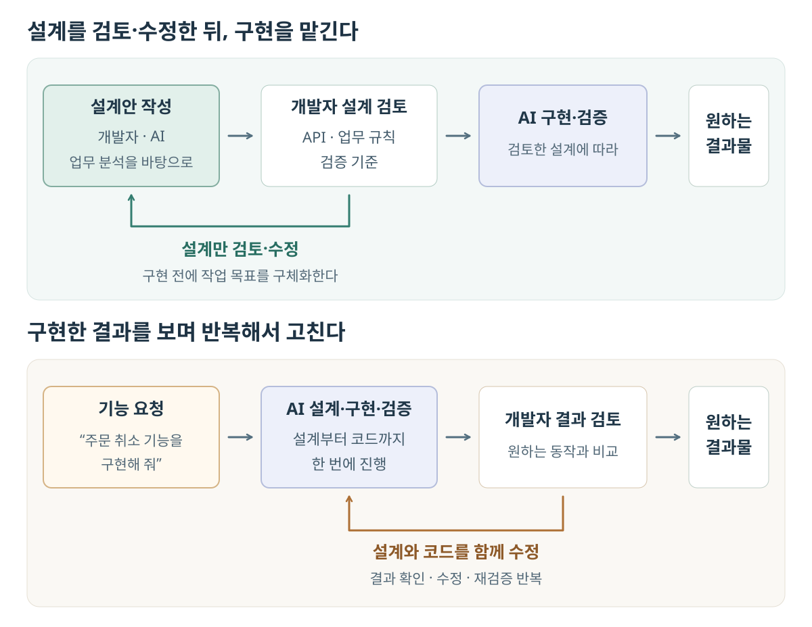
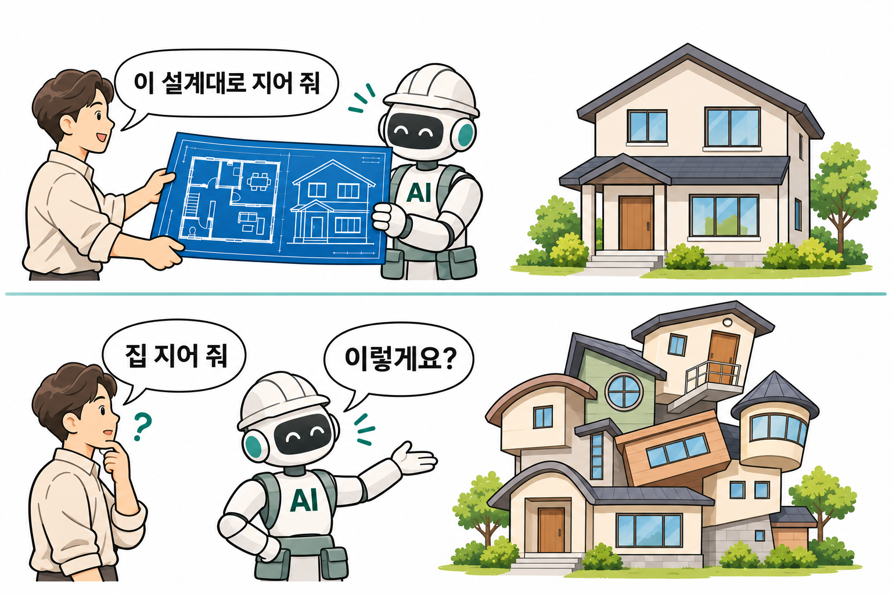
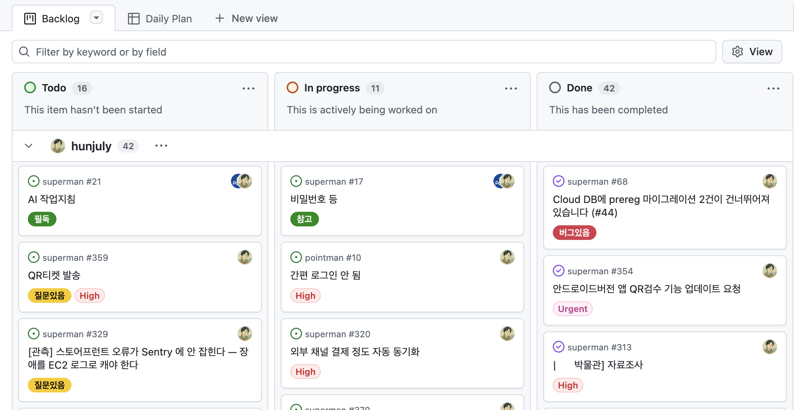
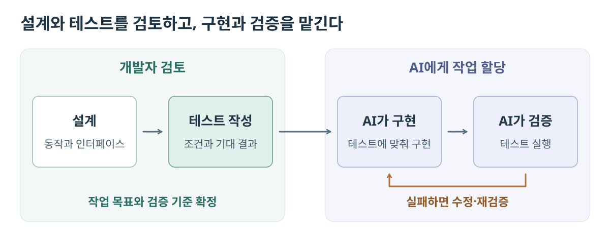

# AI 코딩의 어려움과 개발 전략

어느 날 회사에 출근했더니 모든 구성원에게 기획·디자인·개발을 할 줄 아는 팀원이 100명씩 생겼다.

이제 기획자는 개발자의 작업을 기다리지 않고 자신의 생각을 AI로 바로 구현할 수 있다. 복잡한 서비스 전체를 개발하기는 어렵더라도, 화면과 사용자 흐름을 보여주는 프론트엔드 목업 정도는 충분히 만들 수 있다.

이렇게 화면을 만드는 속도가 빨라지면, 개발자에게는 백엔드를 더 빠르게 구현해야 하는 부담이 생긴다.

다행인 것은 개발자에게도 100명의 팀원이 생겼다는 것이다. 불행한 것은 이들에게 일을 나누어 맡기고 결과를 검증하는 게 어렵다는 것이다.

## 1. AI에게 일을 맡기는 것이 왜 어려울까

AI가 구현을 맡으면서 한 개발자가 담당할 수 있는 일의 양과 범위가 커졌다. 개발자는 작업의 목표를 정하고, AI에게 일을 나누어 맡기고, 결과를 검증하고 통합하는 데 더 많은 시간을 쓰게 된다. 갑자기 커다란 힘을 얻었지만, 달라진 역할에는 아직 익숙하지 않을 수 있다.

### 1.1 하향식 개발에 익숙하지 않다

기능을 구현할 때 DB 테이블부터 만들고, 데이터를 읽고 쓰는 코드를 작성한 뒤 API를 붙여 나가는 경우가 있다. 필요한 동작과 전체 구조를 코드를 작성하면서 구체화하는 것이다. 세부 구현에서 출발하는 상향식 개발의 예다.

이 과정에 의존해 설계해 왔다면, AI에게 구현을 맡기기 전에 작업 목표를 구체화하기 어려울 수 있다. 예를 들어 "상품 검색 기능을 구현해 줘"라고만 요청하면, 검색 조건과 응답 형태, 내부 구조까지 AI가 스스로 정하게 된다. 그 판단이 개발자의 의도와 다르면, 개발자는 결과물을 보고 지시를 보완하면서 같은 작업을 여러 번 다시 맡기게 된다.

이런 재작업을 줄이려면 요구사항에서 출발해 동작과 구조를 정하고, 구현할 작업으로 구체화하는 하향식 개발이 필요하다. UML 등으로 구성 요소의 책임과 인터페이스를 정리하고, 이번 작업의 목표와 검증 기준을 정해 AI에게 구현을 맡긴다.

그러나 이런 설계는 쉽지 않다. 프로젝트에 맞는 아키텍처를 선택하고, 기능이 늘거나 요구사항이 바뀌어도 적절한 구조를 유지하려면 설계 원칙을 상황에 맞게 적용하는 유연한 사고가 필요하다.

코드를 읽으며 동작을 이해하고 확인해 왔다면, 설계와 테스트를 기준으로 구현을 맡기는 일도 불안하게 느껴질 수 있다. 마치 잠수함 안에서 바깥을 직접 보지 못한 채, 계기와 탐지 장비가 전하는 정보로 항해해야 하는 듯한 느낌이다.

개발자는 이제 설계자가 되어야 한다. 따라서 디자인 패턴과 아키텍처에 대한 깊은 이해와 이를 실제 프로젝트에 적용해 본 경험이 무엇보다 중요해졌다.

설계 초안은 AI에게 맡길 수 있다. 다만 그 설계가 요구사항과 프로젝트에 맞는지 개발자가 최종적으로 검토하고 보완해야 한다.

### 1.2 테스트 작성 경험이 부족하다

테스트는 AI에게 맡길 작업의 목표다. 따라서 AI에게 구현을 맡길 때는 테스트로 동작과 기대 결과를 먼저 정하는 TDD를 해야 한다.

이런 테스트가 없다면 AI가 구현을 제대로 했는지 검증하기 어렵다. 개발자가 직접 검증하는 데는 시간이 많이 들고, AI는 잘못된 방법으로 검증할 수도 있다.

문제는 구현에 앞서 테스트를 작성하는 일이 쉽지 않다는 것이다. 구현하면서 동작을 구체화해 온 개발자에게는 입력 조건과 기대 결과를 먼저 정하고, 이를 테스트로 표현하는 일이 낯설 수 있다.

무엇을 얼마나 테스트할지 판단하는 경험도 필요하다. 내부에서 사용하는 함수마다 유닛 테스트를 작성해야 한다고 생각하는 개발자도 있다. 테스트가 내부 구현에 지나치게 의존하면 외부 동작이 바뀌지 않아도 코드 구조를 고칠 때 테스트까지 함께 수정해야 한다.

설계와 마찬가지로 AI가 작성한 테스트도 요구사항을 제대로 검증하는지 개발자가 검토해야 한다. AI는 불필요하거나 중복된 테스트를 많이 작성하기도 한다. 이런 테스트가 쌓이면 검증에 걸리는 시간이 늘고 개발 속도도 느려진다.

### 1.3 프로젝트가 빠르게 커진다

작은 프로젝트에서는 설계가 미흡하거나 테스트가 자동화되어 있지 않아도, 코드를 직접 살펴보고 실행하며 부족한 부분을 메울 수 있었다. 그러나 AI 코딩으로 프로젝트가 빠르게 커지면, 코드를 하나씩 확인하고 작업을 머릿속으로 관리하는 방식으로는 감당하기 어려워진다.

기능이 늘어날수록 서로의 데이터와 동작에 의존하는 관계도 많아진다. 이런 규모를 다뤄 본 경험이 부족하면 리팩터링이 필요한 시점을 놓치기 쉽다. 구조를 정비하지 않은 채 기능을 계속 추가하면 프로젝트의 복잡도가 빠르게 커질 수 있다. 여기에 미완성 기능을 전제로 다른 기능까지 만들어 놓으면, 나중에는 한 기능을 마무리하기 위해 여러 기능을 함께 고쳐야 한다.

테스트를 작성해 그 효과를 체감해 본 경험이 부족하면, 막연히 좋을 것이라고 생각하면서도 바쁜 일정 속에서는 테스트를 뒤로 미루기 쉽다. 프로젝트가 커질수록 이런 경험은 더 중요해진다. 테스트로 오류를 일찍 발견하고 기존 기능을 안심하고 수정해 본 경험은, 기능 구현과 검증 사이에 시간을 배분하는 판단의 바탕이 된다.

관리할 작업도 많아진다. 여러 AI에게 동시에 일을 맡기면 작업의 범위와 우선순위를 정하고 진행 상황을 파악하는 일도 복잡해진다. 작업의 상태와 처리 이력이 정리되지 않으면 후속 작업이 누락되거나, 눈앞에 생긴 일을 처리하느라 중요한 작업이 뒤로 밀릴 수 있다. 다른 팀원도 무엇이 완료됐고 무엇이 남았는지 파악하기 어렵다.

AI가 작업을 빠르게 끝낼수록 개발자가 검토해야 할 결과 보고도 쌓인다. 이를 대충 넘기며 일을 계속 맡기면, 프로젝트의 변화를 따라가지 못해 어느 순간 AI의 설명조차 이해하기 어려워질 수 있다. 결국 다음 작업을 스스로 판단하지 못한 채 AI가 제안하는 일을 그대로 맡기는 역할에 머물 수 있다.

### 1.4 기존 프로젝트의 개발 방식을 바꾸기 어렵다

프로젝트의 설계와 코드, 테스트 환경은 서로 맞물려 있다. 이 기반이 부실한 상태에서 기능을 계속 추가하면, 나중에는 개발 방식을 바꾸는 일도 어려워진다.

설계가 정리되지 않은 프로젝트에서 설계 후 구현을 하려면, 변경할 부분과 관련된 기능의 책임과 의존 관계부터 파악해야 한다. 구성 요소가 복잡하게 얽혀 있다면 테스트를 작성하기 위해 코드와 실행 환경부터 정비해야 할 수도 있다.

AI에게 설계와 테스트를 기준으로 일을 맡기려 해도, 그 기반을 갖추는 데 상당한 작업이 필요한 것이다.

함께 일하는 기획자나 디자이너에게도 익숙한 업무 방식이 있다. AI를 활용한 새로운 역할 분담이 가능하더라도, 요구사항을 전달하고 결과를 검토하는 방식까지 곧바로 바뀌지는 않는다. 서로의 업무 방식을 조정하고 적응하는 데도 생각보다 많은 시간과 노력이 들 수 있다.

## 2. AI 코딩으로 달라지는 개발 방법

분석·설계·테스트의 구체적인 방법은 [백엔드 서비스 분석과 설계](../_posts/2025-04-01-backend-design-1.md)에서 다뤘다.

이 장에서는 AI 코딩으로 개발 방식이 어떻게 달라질 수 있는지 살펴본다.

### 2.1 개발 전략

다음은 AI로 가능해진 몇 가지 개발 방식의 예다.

#### 기획자가 UI를 직접 구현한다

AI를 활용하면 기획자가 자신이 기획한 UI를 직접 구현할 수 있다. 자신의 생각을 AI에게 설명해 화면과 사용자 흐름을 만들고, 직접 조작해 보면서 필요한 기능과 빠진 업무 규칙을 구체화한다.

개발자는 기획자가 AI에게 수정을 요청하고 바뀐 화면을 실행·확인할 수 있도록 프로젝트와 작업 흐름을 마련한다. 백엔드가 준비되지 않았다면 예시 데이터로 화면과 사용자 흐름을 검토할 수 있게 한다. 초기 설정 이후에도 환경이나 실행 문제로 작업이 막히지 않도록 지원한다.

#### 프로토타입과 운영용 프로젝트를 병행한다

여기서 더 나아가 프로토타입과 운영용 프로젝트를 분리해 병행할 수도 있다. 기존에는 두 프로젝트를 따로 개발하려면 개발자의 시간과 인력이 추가로 필요했다. 이제는 기획자가 AI로 프로토타입을 직접 만들고 수정할 수 있어 그 부담을 줄일 수 있다.

두 프로젝트를 병행할 때는 프로토타입으로 구체화한 요구사항과 사용자 흐름을 바탕으로, 기획자와 개발자가 운영용 프로젝트에 반영할 기능의 범위와 우선순위를 정한다. 개발자는 채택한 기능의 업무 규칙을 정제하고, API와 데이터 구조를 설계해 AI에게 구현을 맡긴다. 테스트와 운영에 필요한 조건을 갖춰 서비스에 반영하는 동안, 기획자는 프로토타입에서 다음 아이디어를 계속 실험할 수 있다.

#### 풀스택으로 여러 서비스를 병행한다

프론트엔드와 백엔드를 모두 직접 구현하려면 익혀야 할 기술과 파악해야 할 코드가 많다. 그래서 프론트엔드와 백엔드 개발자를 따로 두고, 각자의 분야에 집중하게 하는 경우가 많았다.

AI에게 구현을 맡기면 한 개발자가 프론트엔드와 백엔드를 함께 담당하는 방식도 선택할 수 있다. 개발자는 화면부터 API와 DB까지 이어지는 동작과 인터페이스를 설계하고, 각 영역의 구현 결과를 검토하고 통합한다.

AI를 활용해 여러 기술 스택을 다루듯, 여러 서비스의 개발도 병행할 수 있다.

#### 개발의 주도권 변화

기존에는 구현에 많은 시간이 들었고, 시행착오에 따른 수정 비용도 컸다. 그래서 기능의 범위와 개발 방식을 정할 때 개발팀의 판단이 중요했다. 비개발자는 기술적인 판단을 검토하기 어려워, 개발팀의 입장이 더 강하게 반영되기도 했다.

프로젝트에 따라서는 기획자가 AI로 직접 구현하고 수정하며 개발을 주도하는 방식도 가능하다. 개발자는 그 결과물을 검토하고, 실제 운영에 필요한 구조와 품질을 갖추는 역할을 맡는 식이다.

정해진 형태는 없다. 현재 상황에 가장 좋은 방법이 무엇인지 끊임없이 고민해야 한다.

### 2.2 작업 관리

스크럼처럼 일정한 주기로 작업을 계획하고 결과를 검토해 온 팀이라면, AI 코딩으로 달라진 구현 속도와 역할 분담에 맞춰 작업 관리 방식도 조정할 수 있다.

#### 더 큰 작업 단위

기존에는 기능 하나를 개발할 때도 기획자와 여러 개발자가 협력했고, 구현에 많은 시간이 들었다. 담당자별로 일을 나누고 진행 상황을 확인하기 위해 작업을 비교적 작은 단위로 관리했다.

AI 코딩에서는 한 사람이 맡을 수 있는 범위가 넓어지고 구현 시간도 줄어든다. 이에 따라 여러 사람에게 나누어 맡기던 일을 하나로 묶어, 작업 단위를 더 크게 잡을 수 있다.

예를 들어 상품 검색 기능을 개발하는 데 5일 정도가 걸려, 다음과 같이 작업을 나누었다고 하자.

- 상품 검색 API 설계
- 상품 검색 API 구현
- 검색 화면 구현 및 API 연동

AI를 활용해 한 사람이 설계부터 구현·검증까지 하루 안에 마칠 수 있다면, 이 과정을 하나의 작업으로 관리하는 것이 효율적이다.

#### 더 짧은 이터레이션

AI로 작업을 빠르게 마칠 수 있게 되면, 결과를 검토하고 다음 작업을 정하는 주기도 함께 조정할 필요가 있다.

기획자가 AI로 동작하는 결과물을 먼저 만들고 개발팀에 기술 검토를 요청하면, 화면과 사용자 흐름을 설명하고 확인하기 위한 회의를 줄이거나 생략할 수 있다. 작업 항목에서 결과와 검토 의견을 주고받으면 정기 회의까지 기다리지 않고 후속 작업을 정할 수 있다.

필요한 검토와 협의를 수시로 할 수 있다면, 이터레이션 주기를 줄이거나 없애고 완료된 작업을 검토하며 다음 작업을 이어갈 수 있다. 이 과정에서도 검증을 마친 변경을 계속 통합해 사용 가능한 상태를 유지한다.

#### 작업 관리의 자동화

작업 관리 도구를 AI와 연결하면, 개발자가 작업을 하나씩 전달하거나 결과를 옮겨 적을 필요가 줄어든다. AI가 작업 항목을 직접 읽고, 진행 상태와 결과를 갱신하도록 할 수 있다.

나는 실제 프로젝트에서 AI가 완료 보고를 작업 항목의 댓글로 남기고 상태를 갱신하도록 했다. 아래는 당시 사용한 GitHub Projects 칸반 보드다.

이렇게 작업 완료 보고를 해당 작업 항목에 모으면, 요구사항과 변경 내용, 검증 결과를 한곳에서 확인할 수 있다. 코드 저장소에 작업별 보고서를 별도 문서로 쌓아 둘 필요도 줄어든다.

더 나아가 AI가 작업 하나를 마친 뒤 다음 작업을 골라 이어서 처리하도록 구성할 수도 있다. 우선순위와 선행 작업의 완료 여부를 확인해, 지금 진행할 수 있는 작업을 선택하게 하는 것이다. 작업 중 발견한 문제나 후속 작업도 관련 작업과 연결해 등록하고, 사람의 판단이 필요한 사항은 표시하도록 한다.

작업 항목은 에이전트 사이에서 요청과 응답을 주고받는 통로로도 쓸 수 있다. 프론트엔드와 백엔드는 한 AI가 함께 다루면 조율을 줄일 수 있다. 별도로 맡아야 한다면 프론트엔드 에이전트가 필요한 API나 수정 사항을 작업 항목으로 요청하고, 백엔드 에이전트가 처리 결과를 남긴다. 프론트엔드 에이전트는 이를 확인해 연동을 이어간다.

이처럼 작업 관리 도구는 여러 AI 에이전트에게 일을 맡기고 진행 상황을 확인하며 결과를 검토하는 프로젝트의 관제센터가 될 수 있다.

### 2.3 설계

AI를 활용하면 설계를 시작하고 구체화하는 일이 이전보다 쉬워진다. 백지 상태에서 추상적인 요구사항을 설계로 옮기는 일은 막막할 수 있다. 그러나 AI에게 원하는 기능과 조건을 설명하면 설계 초안을 얻을 수 있다. 개발자는 제안된 동작과 구조를 참고해 빠진 요구사항을 확인하고, 초안을 수정하며 설계를 이어갈 수 있다.

요구사항을 전달받는 방식도 달라졌다. 이전에는 기획자의 설명만 듣고 프론트엔드와 백엔드 개발자가 동시에 구현을 시작해야 하는 경우도 있었다. 화면과 사용자 흐름이 구체화되지 않은 상태에서 각자 필요한 동작을 예상해야 하니, API와 전체 구조를 설계하는 일도 어려웠다.

이제 기획자는 AI로 동작하는 화면을 만들어 자신의 생각을 보여 줄 수 있다. 개발자는 그 화면을 실행해 보며 사용자 흐름과 필요한 동작을 확인하고, 이를 기준으로 API와 업무 규칙을 구체화할 수 있다.

AI 코딩은 설계에 대한 부담을 줄일 수 있다. 직접 코딩할 때는 대규모 리팩토링에 많은 시간과 노력이 들기 때문에 설계를 더 신중하게 할 필요가 있었다. 그러나 테스트가 잘 갖춰져 있다면 AI에게 리팩토링을 맡겨 수정에 드는 부담을 줄일 수 있다. 불확실한 요구사항을 미리 예상해 설계하기보다, 요구사항이 구체화됐을 때 설계를 보완하는 편이 더 효율적일 수 있다.

UML을 활용하는 방식도 달라질 수 있다. 화면과 API만으로 동작을 충분히 구체화할 수 있다면, 요구사항을 UML로 단계적으로 정리하는 과정은 줄어들 수 있다.

내 경우에는 설계보다 새로 합류한 프로젝트를 분석할 때 UML을 더 많이 사용하게 됐다. AI에게 분석을 요청하면 글로 설명하는 경우가 많다. 복잡하거나 이해하기 어려운 부분을 UML로 그려 달라고 하면, 구성 요소의 관계와 동작 흐름을 훨씬 쉽게 파악할 수 있었다.

코드가 복잡하게 얽혀 UML로도 구조를 파악하기 어렵다면, 다시 만드는 것도 고려할 만하다. 이미 동작하는 제품이 있다면 이를 기준으로 필요한 기능을 정리하고 AI에게 분석부터 구현까지 맡길 수 있다. 구현할 기능이 분명하다면, 기존 코드를 계속 고치는 것보다 빠르게 다시 만들 수도 있다.

설계를 맡겨 보면 아직 AI는 그럴듯한 흉내쟁이처럼 보인다. 그래서 나는 AI끼리 설계와 검토를 끝내는 방식을 추천하지 않는다. 다만 설계를 검토할 숙련된 개발자가 없다면, 차선책으로 다른 AI에게 검토를 맡길 수도 있다.

### 2.4 테스트 환경

<!-- 코드 리뷰는 못하지만 테스트 리뷰는 가능하다. 다른 테스트 작성도 금방 할 수 있다.  -->

테스트를 먼저 정해 두면 AI에게 구현 목표를 실행 가능한 형태로 전달할 수 있다. AI가 이 테스트에 맞춰 구현하고, 실패 원인을 찾아 수정하고 재검증하는 과정을 이어가게 한다.

테스트의 초안도 AI에게 맡길 수 있지만, 어떤 동작을 정답으로 볼지는 개발자가 검토해야 한다. 기대 결과가 요구사항에 맞는지, 필요한 경우가 빠지거나 같은 동작을 과하게 중복 검증하지 않는지 확인하고 AI에게 구현을 맡긴다.

이를 위해 AI가 테스트 데이터 준비부터 실행과 실패 내용 확인까지 직접 수행할 수 있도록 환경을 갖춘다. 필요한 명령과 결과를 확인하는 방법을 프로젝트에 정리해 두고, 같은 조건으로 테스트를 다시 실행할 수 있게 한다. 개발자가 매번 데이터를 초기화하거나 실행 결과를 옮겨 주어야 한다면, AI는 수정할 때마다 사람의 개입을 기다리게 된다.

AI가 짧은 간격으로 수정과 검증을 반복하므로 테스트 실행 비용도 개발 속도에 영향을 준다. 매번 실행할 테스트와 별도로 오래 돌릴 테스트를 구분해, AI가 필요한 검증을 빠르게 수행할 수 있게 한다. 나는 여유 서버가 있으면 동시성 테스트를 24시간 돌린다.

### 2.5 개발 환경

기존에는 코드 리뷰를 통해 클래스와 함수의 이름을 다듬고, 중복되거나 비효율적인 코드를 찾아 개선했다. 그러나 AI가 코드를 빠르게 생성하면서 사람이 모든 변경을 읽고 검토하는 방식으로는 그 속도를 따라가기 어려워졌다. 이제는 코드를 일일이 살펴보기 어려운 상황에서도 가독성과 효율성, 유지보수성을 유지해야 한다.

프로젝트의 언어와 기술에 맞는 린터, 타입 검사기, 포매터를 공통 설정으로 갖춘다. 예를 들어 ESLint로 코딩 규칙을 검사하고, 타입 검사기와 포매터로 타입 오류와 코드 형식을 확인한다. 검사 명령을 프로젝트에 정리해 두고, AI가 코드를 작성한 뒤 직접 실행해 발견한 문제를 수정할 수 있게 한다.

반복적으로 발견되는 문제는 가능하면 검사 규칙이나 공통 설정에 반영한다. 같은 지적을 매번 AI에게 설명하지 않아도 다음 작업부터 확인할 수 있게 하는 것이다. 자동 검사로 판단하기 어려운 책임 분리나 불필요한 의존 관계는 개발자가 주요 변경을 중심으로 검토한다.

### 2.6 테스트와 배포 자동화

한 사람이 신경 써야 할 일이 많아진 만큼, 테스트와 배포 같은 반복 작업은 최대한 자동화해야 한다. 그래야 개발자가 설계와 우선순위 결정처럼 판단이 필요한 일에 집중할 수 있다.

코드 변경 시 코드 검사·테스트·빌드를 자동으로 실행하도록 CI를 구성한다. AI가 실패한 검사와 로그를 확인하고, 수정한 뒤 다시 검증할 수 있도록 연결한다. 개발자가 매번 명령을 실행하고 결과를 옮겨 주는 과정까지 줄일 수 있다.

배포도 같은 절차를 반복할 수 있도록 자동화한다. 검토와 검증을 마친 변경을 정해진 환경에 배포하고, 배포 후 서비스가 정상적으로 시작되는지와 주요 기능이 동작하는지 확인하는 과정도 자동화한다.

## 3. AI 코딩에서 하지 말아야 할 일

### 3.1 단순 중계인 역할

AI에게 결과물을 만들게 했다는 것만으로 자신의 일이 끝난 것은 아니다. 이를 여과 없이 다른 사람에게 전달하면, 자신이 해야 할 검토와 정리를 상대방에게 떠넘기는 셈이다. 이런 단순 중계는 개발에 기여하지 못한 채 전달 단계만 늘려 속도를 늦춘다.

**AI → 사람 → 사람 → AI**의 예로, 백엔드 AI가 작성한 API 명세가 두 개발자를 거쳐 프론트엔드 AI에게 전달되는 경우를 들 수 있다. 검토가 끝난 명세를 두 사람이 단순히 옮겨 주기만 한다면, 다음 작업은 그 전달을 기다려야 한다. 관련 AI가 공유 저장소나 작업 관리 도구에서 검토를 마친 결과물과 작업 상태를 직접 확인할 수 있게 하면, 사람이 단순 전달을 맡는 부담을 줄일 수 있다.

**AI → 사람 → 사람**에서는 AI의 장황한 설명을 검토 없이 그대로 전달하는 것이 문제다. AI는 간단한 문제에도 긴 설명을 내놓을 수 있는데, 이를 그대로 보내면 받는 사람이 필요한 내용을 가려내고 결과의 타당성까지 확인해야 한다. 결과를 검토하거나 상대에게 필요한 내용으로 정리하지 않고 단순히 옮길 뿐이라면, 실제 작업자가 AI에게 직접 일을 맡기고 필요한 질문을 하는 편이 더 효율적이다.

AI의 의견을 검토 없이 자신의 주장을 뒷받침하는 근거로 옮기는 것도 단순 중계의 한 형태다. "AI도 이 방식이 맞다고 했다"는 말에는 자신이 어떤 근거로 판단했는지가 빠져 있다. AI에게 준 정보와 전제에 따라 답변이 달라질 수 있으므로, 제안을 가져온 사람이 프로젝트의 조건에서 왜 그 선택이 적절한지 설명할 수 있어야 한다. 공식 문서나 테스트·실험 결과를 제시할 때도 실제로 그 주장을 뒷받침하는지 확인한다.

### 3.2 무의미한 문서 생성

AI를 쓰면 문서를 쉽게 만들 수 있지만, 그 문서를 읽고 유지하는 비용까지 없어지는 것은 아니다. 문서를 많이 쌓아 둔다고 사람과 AI가 필요한 내용을 빠짐없이 참고하는 것도 아니다.

코드에서 확인할 수 있는 정보는 별도로 문서화하는 것을 최소화한다. 코드가 바뀌어도 문서가 여전히 코드와 일치하는지 자동으로 검증하기 어렵기 때문이다. 필요한 내용은 AI로 현재 코드를 분석해 파악하고, 문서에는 코드만으로 알기 어려운 설계 의도와 제약을 남긴다.

프로젝트에서 계속 참조할 문서는 용도와 갱신·폐기 기준을 분명히 해야 한다. 개별 작업의 진행 상황과 완료 보고는 작업 관리 도구에 남긴다.

### 3.3 잦은 반복 작업

AI의 작업 결과물이 마음에 들지 않아서 재작업을 시키는 일이 많다면 AI에게 너무 복잡하거나 추상적인 일을 지시하는 것은 아닌지 고민해야 한다.

어느 쪽이든 AI에게 충분한 정보를 전달하지 않은 것이기 때문에 설계를 구체적으로 하던가 작업을 여러 개의 작은 작업으로 나눠야 한다.

### 3.4 운영 환경 권한 부여

AI가 개발 환경에서 구현과 테스트를 잘 수행한다고 해서 운영 환경을 자율적으로 관리할 권한까지 넘겨서는 안 된다. 배포는 정해진 절차로 자동화하되, AI가 운영 환경을 임의로 바꿀 수 있는 권한은 주지 않는다.

- 장애 대응을 맡긴다는 이유로 AI가 운영 서버에서 명령을 실행하거나 인프라 설정을 자유롭게 바꾸게 하지 않는다.
- 로그 분석과 수정안 작성은 맡기되, 실제 반영은 검토와 검증을 거친 절차로 제한한다.

### 3.5 작업 공간을 분리하지 않은 병렬 작업

여러 AI가 같은 작업 폴더를 동시에 수정하면, 한 AI가 아직 작성 중인 코드를 다른 AI가 오류로 판단해 고칠 수 있다. 서로의 변경을 덮어쓰거나, 다른 AI의 변경 때문에 테스트가 실패해 원인을 잘못 짚을 수도 있다. 작업을 기능별로 나눴더라도 파일과 실행 환경을 공유하면 이런 간섭이 생길 수 있다.

병렬로 수정하는 작업은 별도의 작업 디렉터리와 브랜치로 분리하고, 검증을 마친 변경을 통합한다. 테스트 DB와 생성 파일 등 작업 중 바뀌는 자원도 서로 간섭하는 부분을 분리해야 한다.

## 4. 개발자는 어떻게 학습하고 성장해야 할까

AI가 더 많은 코드를 구현해 준다고 개발자의 경험도 그만큼 쌓이는 것은 아니다. 직접 구현하면서 문제를 발견하고 설계를 수정해 왔다면, 구현을 AI에게 맡긴 뒤에는 그 과정에서 얻던 배움을 어떻게 이어 갈지 고민해야 한다. 자신의 판단이 어떤 결과를 낳았는지 확인하는 과정을 학습에 남겨야 한다.

### 4.1 소프트웨어 공학의 기본에 집중하기

AI에게 더 좋은 결과를 얻는 요령을 익히는 데만 학습 시간을 쓰지 말아야 한다. 무엇을 구현해야 하는지 정의하고, 설계가 적절한지와 결과가 올바른지 판단할 능력을 먼저 길러야 한다.

- 요구사항 분석, 책임과 의존성 분리, 인터페이스 설계, 테스트와 변경 관리의 기본을 공부한다.
- 배운 원칙을 실제 프로젝트에 적용하면서 어떤 문제를 해결하는지와 적용에 드는 비용을 살펴본다. 데이터베이스·네트워크 같은 기초 지식도 설계의 전제와 한계를 판단하는 데 연결한다.

특정 모델의 약점을 보완하는 프롬프트나 작업 절차는 모델과 도구가 바뀌면 효과도 달라질 수 있다. 실제로 Anthropic은 [하네스 개발 사례](https://www.anthropic.com/research/harness-design-long-running-apps)에서 모델을 바꾸면서 일부 절차를 제거하고, 여전히 도움이 되는 구성은 유지했다. 새로운 AI 활용법은 현재 프로젝트에서 해결할 문제가 있을 때 필요한 범위부터 익히고, 적용 전후의 결과와 도입·유지 비용을 비교한다.

하네스처럼 AI가 작업하는 환경과 실행 절차를 구성하는 기술에도 테스트 실행과 작업 관리 같은 기본이 들어 있다. 이를 익힐 때도 어떤 문제를 해결하는지 이해하고, 프로젝트에 필요한 구성을 선택하는 데 소프트웨어 공학의 기본기를 활용한다.

### 4.2 작은 프로젝트라도 AI의 도움 없이 완성하기

- 직접 구현한 경험이 부족하다면, 작은 프로젝트의 요구사항 정리부터 설계·구현·검증까지 AI의 도움 없이 끝내 본다.
- 요구사항을 코드로 옮기고, 막히는 부분에서 설계를 수정하고, 오류를 추적하는 과정을 경험한다. 규모를 작게 잡더라도 자신이 정한 완료 기준까지 도달해 본다.

### 4.3 시스템에 대한 이해를 넓히기

- AI가 문제를 해결하면 무엇이 원인이었고, 어떤 변경으로 해결됐는지 확인한다. 관련 코드와 데이터 흐름을 따라가며 문제를 일으킨 조건과 구성 요소의 관계를 이해한다.
- 기능을 추가하거나 수정할 때도 요청이 처리되는 흐름과 데이터가 바뀌는 지점, 다른 기능에 미치는 영향을 살펴본다. 이런 경험을 쌓으면서 시스템이 어떻게 동작하는지 설명하고 변경의 영향을 예상할 수 있는 범위를 넓힌다.
- 작은 시스템이라도 배포하고 운영하면서, 처음의 설계가 이후의 변경과 장애 대응에 어떤 영향을 주었는지 돌아본다.

### 4.4 비판적으로 생각하고 계속 ‘왜’를 묻기

- AI의 설명과 제안에 어떤 전제와 근거가 있는지 따져 본다. 왜 이 구조가 필요한지, 더 단순한 방법은 없는지, 조건이 달라져도 적절한지 질문한다.
- 자신이 익숙하게 해 온 선택에도 같은 질문을 던진다. 설명이 그럴듯하더라도 공식 문서와 실제 코드, 테스트·실험 결과가 그 설명을 뒷받침하는지 확인한다.

### 4.5 다양한 기술 지양

- 새로운 기술이 어떤 문제를 해결하고 어떤 제약을 갖는지는 살펴본다. 다만 당장 사용할 일이 없는 언어와 프레임워크, 개발 도구의 세부 사용법을 미리 두루 익히는 데 학습 시간을 분산하지 않는다. 프로젝트에서 필요해졌을 때 공식 문서와 AI의 도움을 받아 필요한 범위부터 익힌다.
- 예를 들어 React로 화면을 만들고 있다면, [Vite](https://vite.dev/guide/) 같은 개발·빌드 도구는 프로젝트에 도입할 때 그 역할과 필요한 설정을 익힌다. 실제 동작을 이해하거나 문제를 해결하는 데 더 깊은 지식이 필요해지면 그 부분을 공부한다.

## 마치며

AI 코딩에서 달라진 것은 각자가 맡는 역할이다. 분석·설계·구현·검증이라는 개발의 기본은 그대로지만, 개발자가 직접 하던 구현을 AI가 맡으면서 누가 어떤 일을 할 수 있고 무엇을 책임져야 하는지가 달라졌다.

직접 구현을 할 때는 배포나 테스트를 수동으로 해도 크게 문제가 되지 않았을 수 있다. 구현에 시간이 많이 드는 만큼 배포/테스트는 상대적으로 작은 부분이었다. 그러나 AI가 구현을 빨리하기 때문에 배포와 테스트도 자동화 해서 AI의 구현 속도에 맞출 수 있어야 한다. 즉, AI가 일을 잘 할 수 있는 환경을 만들어주는 게 개발자의 역할이 된 것이다.
